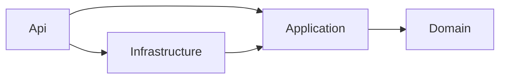

# Backend design

## Layers

Clean Architecture in four projects, the same shape as Money Trail. Dependencies point inwards only; `MantralayaYatra.ArchitectureTests` fails the build if they do not.

| Project | Holds | Must not reference |
|---|---|---|
| Domain | Yatra, members and roles, seva types, ledger entries (booking, payment, reversal), receipt numbers, booking positions | anything else in the solution, EF Core, ASP.NET Core |
| Application | One class per use case, the ports they need (`ILedgerStore`, `IYatraDirectory`, `IUserDirectory`, `ICurrentUser`, `IYatraContext`), wire contracts, `Result<T>` | Infrastructure, Api, EF Core, ASP.NET Core |
| Infrastructure | `YatraDbContext`, the EF adapters for the ports, the yatra lock and the sync sequence | Api |
| Api | Minimal API endpoints, the API key check, the dev sign-in header, membership filter, composition root | — |

## Patterns

- **Use case per class** (`PushLedgerEntries`, `GetDailyRegister`, …) with a single `HandleAsync`. Expected failures come back as `Result<T>` with a stable error code; exceptions are for bugs.
- **Ports and adapters.** Use cases see interfaces; EF Core lives only in Infrastructure. Unit tests use in-memory fakes of the same ports.
- **Read models computed on request.** The register and priest's list are derived from the ledger every time, never stored, so they can never disagree with it.
- **Value calculation in the domain.** `BookingPosition.Of` works out paid, pending and refund due from a booking, its payments and reversals; both reports use it.
- **Endpoint filters for identity.** `ResolveUser` maps the token to a user; `ResolveMembership` checks the caller belongs to the yatra in the route and records their role. A non-member gets 404, the same as for a yatra that does not exist.

## What differs from Money Trail

| Money Trail | This app | Why |
|---|---|---|
| Rows owned by one user | Rows owned by a yatra, shared by its members | Many volunteers keep one set of books |
| Query filter on the user id | Query filter on the yatra id | Same safety: no query can read another yatra's books |
| Lock per user while pushing | Lock per yatra (`sp_getapplock`) | Pushes from different phones must commit in sequence order, and receipt numbers must not repeat or skip |
| Last-write-wins upserts and soft deletes | Append-only entries and reversals | Money needs an audit trail; nothing is overwritten |
| One role | Accounts, Volunteer, Viewer | Only the accountant reverses, sets rates and adds members |
| Change id for idempotency | The entry's own id (made on the phone) | An entry is never edited, so its id is the natural idempotency key |

Kept the same: the sync sequence as the pull cursor, push-then-pull, client-generated ids, integer paise, snake_case tables, a dev header in Development, rate limiting per user, `X-Contract-Version` header, health endpoints.

## Identity and roles

The app has **one user, the accountant**. The phone app carries a long random key (built into the APK, never in the repository) and sends it as `X-Api-Key`; `ApiKeySignIn` compares it in constant time with the web app's `Access__ApiKey` and signs the request in as the owner. The first call creates the internal user `owner` in `app_user`. On the phone, the app itself is locked behind the phone's fingerprint, face or PIN (the fingerprint never leaves the phone; it protects the books from someone holding it). No Azure user directory and no email are involved.

Roles and members remain in the model, per yatra, for a later multi-user version; today the owner is the Accounts member of every yatra they create:

| Role | Can |
|---|---|
| Viewer | Read the register, the priest's list, seva types and members; pull |
| Volunteer | Everything a viewer can, plus push bookings and payments |
| Accounts | Everything, plus reversals, seva rates and limits, adding members |

Adding members (`POST /yatras/{id}/members`) exists in the API but is not used by the app.

## Data

Sevas are soft-deleted (`seva_type.deleted_at`): kept with their bookings, restorable, and a hosted job (`DeletedSevaCleanup`, at start and daily) removes for good those deleted over 60 days ago that were never booked.

Tables (snake_case): `app_user`, `yatra`, `yatra_member`, `seva_type`, `seva_booking`, `seva_payment`, `ledger_reversal`, `receipt_counter`, and the sequence `sync_seq`. Ledger tables are keyed by `(yatra_id, id)` because ids come from phones. A unique index on `ledger_reversal (yatra_id, reversed_entry_id)` holds the "reversed at most once" rule in the database too, and one on `seva_booking (yatra_id, receipt_no)` keeps final receipts unique.

## Testing

- Domain unit tests: positions, receipt numbers, codes, day boundaries in IST, roles.
- Application unit tests: every push rule (duplicates, immutability, limits, part payments, reversals, roles), pull paging, register and priest's list.
- Integration tests: the real API on SQL Server in Docker via Testcontainers: two phones, retries, roles over HTTP, two yatras kept apart.
- Architecture tests: the layer rules above.
